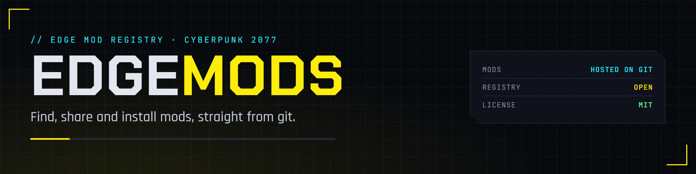
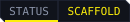
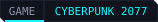
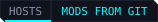

  

  
  
  
  
  

The EDGE mod registry for Cyberpunk 2077. Every mod lives in its author's own git repository; EDGEmods lists them and renders each mod's page from what is in the repository: its README, its images, its releases. Nothing is uploaded twice, and the author keeps everything.

The EDGEmods extension for VS Code browses the registry and installs mods through [REDdeck](https://github.com/Edgemodders/REDdeck). It also publishes a [REDcode](https://github.com/Edgemodders/REDcode) project as a mod in one guided step: the manifest, the page, the images, the repository and the release. Its MCP server lets REDagent or Claude do the same when you say "find me a mod that adds more cars" or "publish my mod".

**[Read the docs](https://edgemodders.github.io/EDGEmods/)** &middot; [Design](docs/design.md) &middot; [Dev setup](docs/dev-setup.md)

> [!NOTE]
> **Status: early build.** The design (draft 0.2) is in progress, and R1, the mod metadata format, is built for review: [edgemods.json](https://edgemodders.github.io/EDGEmods/manifest.html). There is no mod website yet.

## Repository layout

| Path | Contents |
|---|---|
| `packages/format` | The `edgemods.json` format: types, a validator that explains problems in plain words, folder and release checks, the generated JSON schema |
| `examples/example-mod` | An example mod repository that passes the checks |
| `docs/` | Developer documentation: the design, the format, research, dev setup |
| `tools/brand/` | Renders the banner, icon and badges; `activity.svg` is the activity bar icon |

## Legal

EDGEmods is MIT. It hosts no mod files: each mod is distributed from its author's repository under the author's own license. This repository contains no game files and no data extracted from them. Single-player modding only. EDGEmods is not affiliated with CD Projekt RED.

## License

[MIT](LICENSE)
