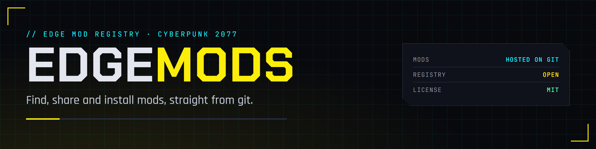
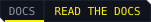
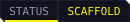
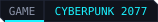
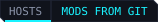
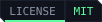

  

  
  
  
  
  

The EDGE mod registry for Cyberpunk 2077. Every mod lives in its author's own git repository; EDGEmods lists them and renders each mod's page from what is in the repository: its README, its images, its releases. Nothing is uploaded twice, and the author keeps everything.

The EDGEmods extension for VS Code (being built: phases R4 and R5; it signs in, browses and installs so far) browses the registry and installs mods through [EDGEdeck](https://github.com/Edgemodders/EDGEdeck). It will also publish a [REDcode](https://github.com/Edgemodders/REDcode) project as a mod in one guided step: the manifest, the page, the images, the repository and the release. Its MCP server will let REDagent or Claude do the same when you say "find me a mod that adds more cars" or "publish my mod".

**[Read the docs](https://edgemodders.github.io/EDGEmods/)** &middot; [Design](docs/design.md) &middot; [Dev setup](docs/dev-setup.md)

> [!NOTE]
> **Status: early build, nothing to use yet.** Built for the owner's review: R1, the mod metadata format ([edgemods.json](https://edgemodders.github.io/EDGEmods/manifest.html)); R2, the registry and its merge checks ([registry](https://edgemodders.github.io/EDGEmods/registry.html); one test mod has passed them); R3a and R3b, the indexer and a website that runs on a PC ([dev setup](https://edgemodders.github.io/EDGEmods/dev-setup.html#run-the-website-on-this-pc)); R3c, accounts (Auth0 sign-in, likes, the Account page), tested against a stand-in for Auth0, and signed in with GitHub, Google and email on the real development tenant (2026-11-21); R3d, downloads (counted, a Downloaded mods list); R3e, the Admin page (hide and block mods, block accounts, reports, the blocklist); R4a and R4b, the first parts of the EDGEmods extension (signing in from VS Code; finding mods and their pages in VS Code), and R4d's first part (finding mods from an assistant, through MCP); R4c, installing a mod and its requirements through EDGEdeck 0.34 (from the website's Mod manager button, a mod's tab, a command, or an assistant's `mods_install`), tested against stand-ins, the owner's hand test not run yet. Being built: R3h, the deploy to edgemods.ai ([deploy](https://edgemodders.github.io/EDGEmods/deploy.html)); the scripts are written and not yet run on the server. Not built yet: subscriptions, the live site at edgemods.ai, and publishing from the extension. There is no release yet. The design is draft 0.2.

## Repository layout

| Path | Contents |
|---|---|
| `packages/format` | The `edgemods.json` format: types, a validator that explains problems in plain words, folder and release checks, the generated JSON schema |
| `packages/checks` | The registry's merge checks, run by `.github/workflows/registry.yml` on each publishing pull request |
| `packages/indexer` | Builds the website's database (`index.db`) from the registry and the mods' repositories |
| `packages/server` | The mod website: pages, search, mod pages, accounts, likes, downloads, admin, install plans (R3b to R3e) |
| `extensions/edgemods` | The EDGEmods extension for VS Code and its MCP server: sign-in, browse, install through EDGEdeck (R4) |
| `registry/` | The registry: one small file per mod |
| `examples/example-mod` | An example mod repository that passes the checks |
| `docs/` | Developer documentation: the design, the format, the registry, the website prototype (`docs/prototype/`), research, dev setup |
| `tools/brand/` | Renders the banner, icon and badges; `activity.svg` is the activity bar icon |

## Legal

EDGEmods is MIT. It hosts no mod files: each mod is distributed from its author's repository under the author's own license. This repository contains no game files and no data extracted from them. Single-player modding only. EDGEmods is not affiliated with CD Projekt RED.

## License

[MIT](LICENSE)
